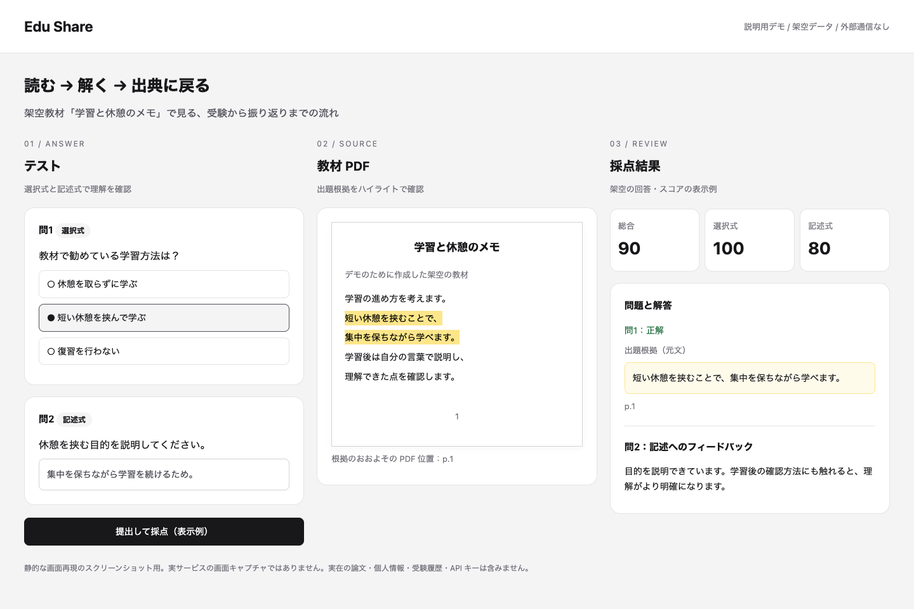
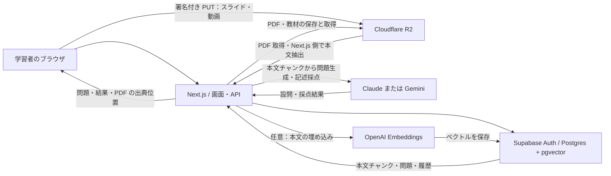

# Edu Share

入試の過去問や論文の PDF をアップロードすると、資料を取り込み、受験のたびに選択式・記述式がミックスされたテストを生成する学習用 Web アプリです。

## 解いている課題と利用者

入試過去問を繰り返し解く受験生や、論文を読んで理解を確かめたい学習者向けです。PDF を読むだけでは「どこが分かっていないか」を見つけにくく、問題を手作業で作るには時間がかかります。Edu Share は PDF の本文から選択式・記述式の問題を作り、回答後に元の資料へ戻って確認できるようにします。

LLM の回答をそのまま正解として覚え込まないために、出題根拠の抜粋・ページ位置を保存し、結果画面で PDF の該当箇所をハイライトします。出典は答えを検証する手がかりであり、生成内容の正しさを保証するものではありません。

## デモ：受験から出典の確認まで



上は **架空の教材・回答だけを使った静的デモ画面のスクリーンショット** です。実サービスのセッションを撮影したものではなく、画面の流れを説明するための再現です。実在の論文本文、個人情報、受験履歴、認証情報は使っていません。[デモ HTML](docs/demo/quiz-flow.html) をダウンロードしてブラウザで開くと、外部通信なしで同じ表示を確認できます（操作・採点は行いません）。

1. PDF を登録し、本文から作られた選択式・記述式に回答する。
2. 結果の根拠抜粋と PDF ハイライトを照合する。
3. 設問ごとの正誤・記述へのフィードバックから復習する。

## できること

- **PDF からテスト教材を作る** — 過去問（学校）と論文の 2 区分。本文をチャンクに分けて保存し、受験時に LLM が問題を作って記述の採点も行う
- **受験と振り返り** — 結果画面で出典箇所を PDF 上にハイライト表示。受験履歴と設問ごとの正答状況、理解度を確認できる
- **論文の補助教材** — NotebookLM のスライド・動画・クイズ／単語帳 CSV、SciSpace のリンクを論文に紐づけて閲覧・受験できる
- **整理** — ブックマークリスト、論文の学習ステータス、著者・業界・学校などの選択肢（ピックリスト）

## 構成

| 役割 | 使っているもの |
| --- | --- |
| フレームワーク | Next.js 15（App Router）/ React 19 / TypeScript / Tailwind CSS |
| 認証・DB | Supabase（Auth、Postgres、pgvector） |
| ファイル保存 | Cloudflare R2（PDF・スライド・動画の本体。DB にはオブジェクトキーだけ残す） |
| 問題生成・採点 | Anthropic Claude または Google Gemini |
| 埋め込み（任意） | OpenAI `text-embedding-3-small` |



PDF の本文をページ付きで抽出・分割し、DB に保存します。問題生成へ渡すチャンクを選び、根拠抜粋と照合できた PDF 座標を設問に紐づけて保存します。ファイル本体は R2、検索・学習状態は Postgres に分けています。埋め込みキーがない場合も、ランダムなチャンク選択で出題できます。

```
src/app/          画面と API（Route Handlers）
src/components/   画面部品
src/lib/          取り込み・問題生成・ストレージなどのロジックと単体テスト
supabase/         マイグレーション SQL
tools/            移行スクリプトと論文アップロード自動化ツール
docs/             運用メモ
```

## 技術的な難所と判断

| 難所 | 判断とトレードオフ | 実装・検証の入口 |
| --- | --- | --- |
| スキャン PDF から本文が取れない | 本文が空なら警告を残し、LLM の新規出題を無効にする。推測で問題を作るより、テキストをコピーできる PDF への差し替えを促す | [取り込み](src/lib/ingest-pdf.ts)、[出題可否](src/lib/document-chunks.ts) |
| PDF の特殊フォント由来の文字で DB 保存が失敗する | 保存前に NUL・不要な制御文字を除去し、不正なサロゲートを置換する。改行と正常な Unicode は保持する | [サニタイズ](src/lib/sanitize-pdf-text.ts)、[テスト](src/lib/sanitize-pdf-text.test.ts) |
| 生成された根拠と PDF の表示位置を結びつける | 根拠の元文と照合できた矩形を出題時に固定し、振り返り時に使う。抽出状態によって位置を特定できない場合もある | [根拠の保存](src/lib/attach-source-pdf-highlights.ts)、[PDF 表示](src/components/QuizSessionPdfAnnotator.tsx) |
| Supabase Storage から R2 への移行 | DB のオブジェクトキーを保ってファイルの保存先を分離する。移行はコピー・サイズ確認を先に行い、元データ削除は明示オプションにする。サイズ確認は内容の完全一致の保証ではない | [移行手順と制約](docs/r2-storage.md)、[ストレージ層](src/lib/object-storage.ts) |

## セットアップ

### 外部サービスなしでテストする

Node.js **22.18 以上の 22 系（または 24 系）** と npm、Git を用意します。TypeScript を Node 標準ランナーで実行するため、22 系の初期バージョンではなく型除去が既定で有効なバージョンを使ってください。CI は Node.js 22 を使います。

```bash
git clone https://github.com/doren-hub/Edu-Share.git
cd Edu-Share
npm ci
npm test
npm run lint
```

この手順では `.env.local` や API キー、Supabase、R2 は不要です。テストはローカルのフィクスチャ・モックを使い、本番サービスに接続しません。依存パッケージの初回取得にはネットワークが必要です。

### アプリを動かす場合

以下は独立した開発用 Supabase・R2 と LLM キーを準備する手順です。実データのある本番環境を検証先に使わず、キーをコミットしないでください。サービス利用料が発生する場合があります。

```bash
cp .env.example .env.local
```

### 1. Supabase

1. Supabase でプロジェクトを作り、`NEXT_PUBLIC_SUPABASE_URL`、`NEXT_PUBLIC_SUPABASE_ANON_KEY`、`SUPABASE_SERVICE_ROLE_KEY` を `.env.local` に書く
2. Database → Extensions で `vector` を有効にする
3. SQL Editor に [supabase/apply_all_migrations.sql](supabase/apply_all_migrations.sql) を貼り付けて実行する（`supabase/migrations/` の全マイグレーションを 1 本にまとめたもの。詳細は [docs/database-migrations.md](docs/database-migrations.md) を参照）

「exam_period が schema cache に無い」のようにスキーマの反映だけが遅れているときは、[supabase/sql_editor_tests_app_columns.sql](supabase/sql_editor_tests_app_columns.sql) と [supabase/sql_editor_reload_postgrest_schema.sql](supabase/sql_editor_reload_postgrest_schema.sql) を順に実行します。

### 2. Cloudflare R2

バケットと Object Read & Write 権限の API トークンを作り、`R2_*` を設定します。スライドと動画はブラウザから直接アップロードするため、バケットの CORS 設定も必要です。手順は [docs/r2-storage.md](docs/r2-storage.md) にあります。

### 3. LLM

`ANTHROPIC_API_KEY` か `GEMINI_API_KEY` のどちらか一方を設定します。両方ある場合は Anthropic が使われ、Gemini を優先したいときは `LLM_PROVIDER=gemini` を指定します。モデル名や再試行回数の指定は [.env.example](.env.example) のコメントを参照してください。

`OPENAI_API_KEY` は任意です。未設定のときはベクトル検索を行わず、チャンクをランダムに選んで出題します。

### 4. 起動

```bash
npm run dev
```

http://localhost:3000 を開き、サインアップしてから「アップロード」で PDF を登録します。

## コマンド

| コマンド | 内容 |
| --- | --- |
| `npm run dev` | 開発サーバー |
| `npm run build` / `npm start` | 本番ビルドと起動 |
| `npm run lint` | ESLint（CI でも実行） |
| `npm test` | `src/**/*.test.ts` の単体テスト（Node 標準のテストランナー） |
| `npm run db:build-apply-all` | 個別マイグレーションから `supabase/apply_all_migrations.sql` を再生成する |
| `npm run storage:migrate:r2` | Supabase Storage のファイルを R2 へ移す。詳細は [docs/r2-storage.md](docs/r2-storage.md) |
| `npm run backfill:pdf-filename` | 既存の論文に PDF ファイル名を埋め戻す |

## 品質の担保と開発の進め方

- `npm test` は Node 標準ランナーで、PDF テキスト処理、出典座標、出題・採点データ、ストレージなどの単体テストを実行します。一部の SQL 検証にはローカルの PGlite を使います。
- [GitHub Actions](.github/workflows/ci.yml) は `npm ci`、lint、アプリの単体テスト、マイグレーション集約ファイルの整合性確認を実行します。別ジョブでは paper-pipeline のテスト・型検査も行います。実サービスを操作する E2E テストや、生成問題の学習効果の保証とは別です。
- [開発ワークフロー](docs/development-workflow.md) は kurukuru による Issue → Draft PR → 実装・ローカル検証 → 独立した Claude レビュー → CI → マージです。指摘があれば同じレビューセッションで修正を再確認します。
- AI は実装・テスト・ドキュメント案と独立レビューを担当します。人が課題・受け入れ条件・対象範囲を決め、本番データの扱いや公開方針を判断します。Issue ごとに許可された範囲で runner が PR 操作を進め、変更と検証結果を PR に残します。AI のレビューだけで品質を保証する運用ではありません。

## 既知の制約と今後

- 画像のみの PDF の OCR は取り込み処理にありません。本文抽出できない資料では新規出題を止めます。PDF のレイアウトや文字抽出精度によって、根拠位置の推定・ハイライトに限界があります。
- LLM の生成・記述採点は誤りや揺れがあり、呼び出しには待ち時間・料金・レート制限があります。入試の公式採点や専門的判断を代替しません。
- 問題生成・採点時には本文チャンクや回答が外部 LLM に送られます。任意の埋め込みを有効にすると本文は OpenAI にも送られます。アップロードする資料の利用権と機密性を確認してください。
- 上のデモは画面の説明用です。実環境での認証、アップロード、生成から採点までの動作確認は別途必要です。
- 今後は、[問題品質の評価基準](docs/question-quality-rubric.md) に沿った評価と、PDF 抽出・根拠照合の改善を進めます。具体的な優先順は [Issues](https://github.com/doren-hub/Edu-Share/issues) で管理します。

## 論文アップロードの自動化

NotebookLM・SciSpace・Edu Share をログイン済みの Chrome で順に操作し、論文 PDF の登録から補助教材の取り込みまでを自動で進めるツールが [tools/paper-pipeline](tools/paper-pipeline) にあります。本体とは別の npm パッケージで、準備と使い方は [tools/paper-pipeline/README.md](tools/paper-pipeline/README.md) を参照してください。
